  

  

⚔️ ━━━━━━━━━━━━━━━━━━━━━ 🥷 ━━━━━━━━━━━━━━━━━━━━━ ⚔️

## 侍の履歴書 · The one-line brief

> **Aspiring Machine Learning Engineer building the path from data to dependable software.**
>
> I turn messy datasets and ML ideas into reproducible experiments, deployable APIs, and maintainable automation. My current focus is the engineering layer around models: data versioning, experiment tracking, containerization, CI/CD, and cloud-ready deployment.

`Python` `SQL` `C/C++` `Machine Learning` `Deep Learning` `NLP` `MLOps` `Model Serving` `Data Pipelines` `Experiment Tracking` `Docker` `DVC` `MLflow` `FastAPI` `GitHub Actions` `AWS` `Azure`

⌘ ───────────────────── ◈ ───────────────────── ⌘

## 🗺️ 道 · The path I build on

```mermaid
%%{init: {'theme':'base','themeVariables':{'primaryColor':'#15151B','primaryTextColor':'#F2E9DC','primaryBorderColor':'#DC143C','lineColor':'#D4AF37','secondaryColor':'#26101A','tertiaryColor':'#0A0A0A','fontFamily':'sans-serif'}}}%%
flowchart LR
    A[Raw data] --> B[Validate & transform]
    B --> C[Train & evaluate]
    C --> D[Track with MLflow]
    D --> E[Version with DVC]
    E --> F[Package with Docker]
    F --> G[Serve with FastAPI]
    G --> H[Automate with CI/CD]
    H --> I[Deploy & monitor]
    I -. drift / feedback .-> B
```

The goal is not just a high score in a notebook. The goal is a system that can be reproduced, tested, shipped, and improved.

⌘ ───────────────────── ◈ ───────────────────── ⌘

## 🏯 任務 · Selected missions

These are the repositories that best show how I am practicing the full ML engineering loop.

| Mission | What it demonstrates | Stack |
|---|---|---|
| [🏠 House Price Predictor](https://github.com/MitadruMridha05/House_Price_predictor) | End-to-end prediction workflow with model training, DVC versioning, experiment tracking, Docker deployment, and CI/CD automation. | `Python` `scikit-learn` `DVC` `Docker` `GitHub Actions` |
| [🍷 MLflow Test](https://github.com/MitadruMridha05/MLflow-test) | Reproducible wine-quality experiments with tracked runs and model management. | `Python` `scikit-learn` `MLflow` `DagsHub` |
| [🎥 YouTube Sentiment Analysis](https://github.com/MitadruMridha05/Youtube_Sentiment_Analysis) | NLP workflow covering text preprocessing, sentiment modeling, and visualization. | `Python` `NLP` `pandas` `visualization` |
| [🧠 Autonomous AI Task Worker](https://github.com/MitadruMridha05/Autonomous_AI_Task_Worker) | Prototype of an AI worker that accepts a natural-language task and attempts to complete it with a computer. | `AI agents` `automation` `Python` |

<b>More repositories</b>

- [Basic ML Notes](https://github.com/MitadruMridha05/Basic-ML-Notes) — quick revision notes for core machine learning concepts.
- [DSA LeetCode](https://github.com/MitadruMridha05/DSA_leetcode) — ongoing problem-solving practice.
- [Basic DSA Codes](https://github.com/MitadruMridha05/basic_dsa_codes) — data structures and algorithms in C/C++.

⌘ ───────────────────── ◈ ───────────────────── ⌘

## ⚔️ 武器 · Engineering toolkit

### Languages & data

### Machine learning

### MLOps, deployment & cloud

## 🥋 修行 · Current training

- Building more end-to-end ML projects with clear model cards, evaluation metrics, and reproducible setup instructions.
- Deepening deployment skills around FastAPI, Docker, CI/CD, cloud services, observability, and model/data drift.
- Strengthening fundamentals in statistics, algorithms, system design, and production Python.

## 📈 戦果 · GitHub activity

 

## 🐍 影の蛇 · Contribution trail

<picture>
  <source media="(prefers-color-scheme: dark)" srcset="https://raw.githubusercontent.com/MitadruMridha05/MitadruMridha05/output/github-snake-dark.svg" />
  <source media="(prefers-color-scheme: light)" srcset="https://raw.githubusercontent.com/MitadruMridha05/MitadruMridha05/output/github-snake.svg" />
  
</picture>

⚔️ ━━━━━━━━━━━━━━━━━━━━━ 🥷 ━━━━━━━━━━━━━━━━━━━━━ ⚔️

## 🦅 連絡 · Send a messenger hawk

I am open to ML engineering, MLOps, software engineering internships, collaborative projects, and thoughtful conversations about building useful AI systems.

  

**学ぶ → 作る → 展開 → 改善**  ·  *Learn → Build → Deploy → Improve*

